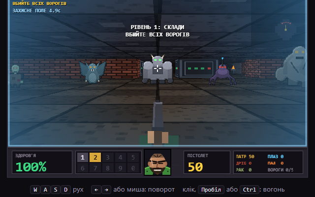

# Doom-like

Шутер від першої особи в дусі класичних шутерів 90-х, зроблений на raycasting-рушії в браузері. Код, графіка й музика
оригінальні: текстури, монстри та зброя малюються процедурно на `<canvas>`, а рок/метал-саундтрек синтезується через Web Audio.



- 30 рівнів, що генеруються процедурно (той самий рівень і складність дають ту саму карту)
- 27 типів монстрів і 6 боссів: проміжні на рівнях 5, 15, 25 і головні на 10, 20, 30
- 10 видів зброї: бензопила, пістолет, обріз, автомат, кулемет, ракетниця, плазмомет, вогнемет, рейкган, руйнівник
- 3 рівні складності, автозбереження прогресу в `localStorage`

## Запуск

Збирати нічого не треба. Відкрийте `index.html` у браузері: подвійний клік працює, бо гра запускається і з `file://`.

Інший варіант — запустити будь-який статичний сервер у корені репозиторію, наприклад `npx serve .` або `python -m http.server`.

## Керування

| Дія | Клавіші |
| --- | --- |
| Рух | `W` `A` `S` `D` |
| Поворот | `←` `→` або миша (клік по екрану захоплює курсор) |
| Вогонь | клік, `Пробіл` або `Ctrl` |
| Вибір зброї | `1`–`9`, `0`, `Q` / `E` або колесо миші |
| Перезапуск рівня | `R` |
| Пауза | `Esc` / `P` |
| Гучність | `M` |
| Чутливість миші | `[` / `]` |
| Повний екран | `F` |

На телефоні чи планшеті: стік зліва (з'являється під пальцем) рухає, свайп справа повертає камеру, кнопка з прицілом
знизу справа стріляє (її можна тягнути, щоб водночас повертатися), тап по слотах зброї внизу змінює зброю, кнопка вгорі
ставить паузу. Гра краще працює в ландшафтній орієнтації.

Геймпад (Xbox, PlayStation та інші зі стандартною розкладкою): лівий стік або хрестовина рух, правий стік поворот,
`RT` вогонь, `LB` / `RB` або `Y` зміна зброї, `Start` пауза, `Back` гучність, `A` підтвердження в меню. Браузер
показує геймпад грі лише після натискання будь-якої кнопки.

Мета рівня — знищити всіх ворогів або знайти ключ-кристал, після чого дійти до порталу. Патрони обмежені, бензопила
працює без них. На старті рівня кілька секунд діє захисне поле.

## Структура

```
index.html        сторінка, стилі, підказки по клавішах; підключає скрипти з js/
js/core.js        канва, константи, таблиця складності, спільні хелпери
js/textures.js    процедурні текстури стін і підлоги
js/monsters.js    спрайти й параметри монстрів
js/level.js       генерація рівнів
js/game.js        стан гри, збереження, бій, оновлення кадру
js/audio.js       звукові ефекти й синтезована музика
js/input.js       клавіатура й миша
js/touch.js       сенсорне керування (стік, кнопки на екрані)
js/gamepad.js     геймпад (Gamepad API)
js/render.js      рендер світу, зброї, HUD
js/main.js        головний цикл
```

Модулі підключаються звичайними тегами `<script>`, а не ES-модулями, щоб гра працювала з `file://`. Тому імена,
оголошені на верхньому рівні одного файлу, видно в усіх інших, і порядок тегів у `index.html` має значення.

## Розробка

- Код форматується через [Prettier](https://prettier.io/), налаштування лежать у `.prettierrc`:
  `npx prettier@3.3.3 --write "js/*.js"`
- Для налагодження й тестів гра відкриває `window.__doom`: `newGame()`, `startLevel(n)`, `player`, `enemies`, `state` тощо.
- План покращень і їхній статус ведуться в [IMPROVEMENTS.md](IMPROVEMENTS.md).
